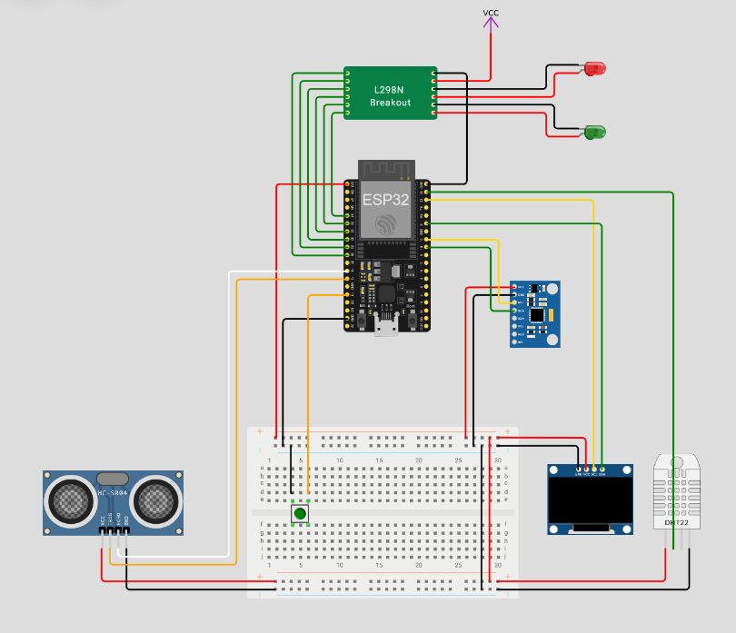
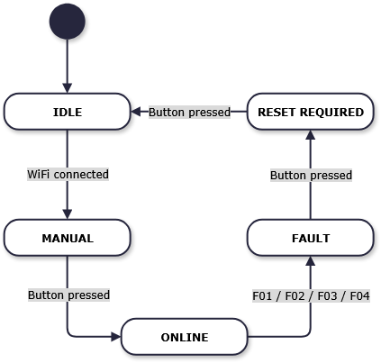
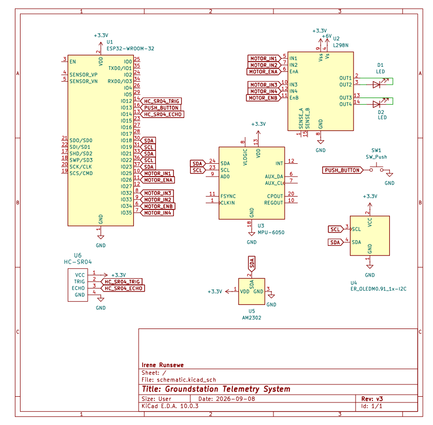

# Groundstation


A project I built to drive a small WiFi car from the browser and watch its sensors live.

An ESP32 runs the car on FreeRTOS tasks. It reads tilt from an MPU6050, keeps both wheels at the same speed with **PID control on the wheel encoders**, and stops the motors through a **5-state fault state machine** if something goes wrong. Telemetry streams to a web dashboard 10 times a second, and a Python tool records it and checks for dropped or broken messages.

<div align="left">
  
</div>

## How It Works
**1. FreeRTOS Tasks**

The work is split into four tasks. Each one uses `vTaskDelayUntil()`, so its period stays fixed instead of drifting with however long the work took.

| Task | Core | Priority | Period | Stack (bytes) | Job |
| --- | --- | --- | --- | --- | --- |
| control | 1 | 5 | 20 ms | 4096 | IMU, filter, fault checks, state machine, PID, motors |
| sensor | 0 | 3 | 100 ms | 3072 | Ultrasonic every 100 ms, DHT22 every 2 s |
| telemetry | 1 | 2 | 100 ms | 4096 | Builds one telemetry line, prints it on Serial, queues it for the WebSocket, OLED at 1 Hz |
| net | 0 | 2 | 10 ms | 6144 | WiFi, web page, WebSocket |

The control task has the highest priority because the PID and the safety checks need steady timing. The ultrasonic and DHT22 reads busy-wait for several ms, so they run on the other core. The control task measures its own run time and the time between wake-ups, and sends the average and worst in every telemetry message. Every 5 s the free stack of each task is printed on Serial as `#STACK ...`.

**2. Sensor Fusion and PID**

The MPU6050 accelerometer gets jittery when the motors vibrate, and the gyroscope slowly drifts. A complementary filter takes the good part of each:

```
angle = 0.98 * (angle + gyro_rate * dt) + 0.02 * accel_angle
```

Motors never spin at exactly the same speed, so without control the car drifts to one side. Each wheel has its own PID loop that compares encoder ticks per second to the target speed and adjusts the PWM. The integral is clamped so it can't wind up when a wheel is stuck.

The PID, the filter, the fault checks and the state machine are plain C++ in `lib/gs_core` with no Arduino includes, so I can test them on my PC.

**3. Fault State Machine**

There are 5 states: IDLE, ONLINE, MANUAL, FAULT and RESET_REQUIRED. The motors can only run in MANUAL.

<div align="left">
  
</div>

| From | To | When |
| --- | --- | --- |
| IDLE | ONLINE | WiFi connected |
| ONLINE | IDLE | WiFi lost |
| ONLINE | MANUAL | Button pressed |
| MANUAL | FAULT | Any fault below |
| FAULT | RESET_REQUIRED | Button pressed or ACK from the dashboard |
| RESET_REQUIRED | IDLE | Button pressed or RESET from the dashboard |

| Code | Meaning |
| --- | --- |
| F01 | Obstacle 15 cm or closer for more than 1 s |
| F02 | Pitch or roll past 30 degrees |
| F03 | Temperature 40 C or more |
| F04 | No `ping` from the dashboard for 500 ms (watchdog) |
| W01 / W02 | Warnings: obstacle 16-29 cm, temperature 35-40 C |

The button acts on the press, so holding it down only counts once. Every state change is printed on Serial as `#FSM ...`, and when a fault happens, the last 8 faults are printed as `#HIST ...`.

**4. Telemetry**

Every message is one text line with a sequence number, a time stamp, the sensor values, the state and a checksum:

```
$GS,seq,t_ms,pitch,roll,spd_l,spd_r,pwm_l,pwm_r,dist_cm,temp_c,state,fault,warn,faults,loop_avg_us,loop_max_us,period_max_us*CS
$GS,42,8123,1.25,-0.40,60.0,58.5,141,147,57,23.4,MANUAL,-,-,0,812,1430,20110*2D
```

The checksum is the XOR of every character between `$` and `*`, like the NMEA sentences GPS modules send. Every field is explained in one place, at the top of `lib/gs_core/telemetry_format.h`.

**5. Groundstation Tool**

`tools/groundstation.py` reads the telemetry from the WebSocket, USB serial, a saved log, or a fake mode. It saves a CSV, prints a summary and saves a plot. It uses the sequence number to count dropped and out-of-order messages, and the checksum to count bad ones.

## Shared Data Between Tasks

When everything ran in one `loop()`, only one thing ran at a time. Splitting into tasks on two cores made some data shared, so each piece is protected:

| Shared data | Written by | Read by | Protected with |
| --- | --- | --- | --- |
| `g_shared` ping time and dashboard commands | net task | control task | Mutex |
| `g_shared` distance and temperature | sensor task | control, telemetry | Mutex |
| `g_shared` angles, speeds, state, loop times | control task | telemetry task | Mutex |
| `s_ticksL`, `s_ticksR` encoder counts | Encoder interrupts | control task | Spinlock |
| Telemetry lines | telemetry task | net task | Queue |

The encoder counts were the clearest case. The old code read the tick count and set it to 0 on a separate line, so with real interrupts, an edge that landed between those two lines would be lost. `readAndClearTicks()` now does both inside a critical section. An interrupt can't wait on a mutex, so it uses a spinlock instead. The WebSocket library isn't thread safe, so only the net task calls it.

To check this, I went through every read and write of `g_shared` and the tick counters and made sure each one is inside the lock.

## Getting Started
I developed this using WSL2 on Windows with PlatformIO.

### 1. WiFi Settings

```bash
cp include/secrets.example.h include/secrets.h
```

Then put your WiFi name and password in `include/secrets.h`. That file is in `.gitignore`, and the build stops with an error message if it's missing. The example file has the Wokwi simulator's guest network.

### 2. Build

```bash
pipx install platformio
pio run -e esp32dev
```

### 3. Flash

WSL2 can't see USB devices by itself, so the board has to be passed in with usbipd-win.

**Windows PowerShell (as admin)**

```powershell
winget install --interactive --exact dorssel.usbipd-win
usbipd list                        # find the ESP32 (CP210x or CH340) and its BUSID, e.g. 1-4
usbipd bind --busid 1-4            # once per device
usbipd attach --wsl --busid 1-4    # every time you plug it in
```

**WSL2**

```bash
ls /dev/ttyUSB* /dev/ttyACM*       # should show /dev/ttyUSB0 or similar
sudo usermod -aG dialout $USER     # once, then run "wsl --shutdown" in Windows and reopen
pio run -e esp32dev -t upload --upload-port /dev/ttyUSB0
pio device monitor -b 115200 -p /dev/ttyUSB0
```

When you're done, run `usbipd detach --busid 1-4` in PowerShell. You can also skip WSL for this step and press Upload in the PlatformIO extension in VS Code on Windows.

The Serial monitor prints the IP address. Open it in a browser to get the dashboard.

### 4. Wokwi Simulator

Run `pio run`, then "Wokwi: Start Simulator" in VS Code.

| Service | URL |
| --- | --- |
| Dashboard | http://localhost:8180 |
| WebSocket | ws://localhost:8181 |

## Testing
To run everything that doesn't need the board:

```bash
./scripts/check.sh
```

This builds the code in `lib/gs_core` with g++ and runs the tests in `host_tests/` (plain `assert`):

* **PID:** step response on a simple motor model, output limit, integral clamp, and the two wheels staying independent
* **Filter:** known tilt angles, no jump on the first sample, gyro-only integration, and settling to the accelerometer angle
* **Fault checks:** every fault and warning, the 1 s obstacle timer, a failed temperature read, and `millis()` wrapping around
* **State machine:** every state and every transition, including recovery from a fault back to MANUAL
* **Telemetry:** the exact line format and checksum

It also runs the Python tests, does a fake telemetry run, checks that `include/secrets.h` isn't tracked by git, and runs `pio run` if PlatformIO is installed.

### Groundstation Tool

You'll need Python and matplotlib (`pip install -r tools/requirements.txt`).

```bash
python3 tools/groundstation.py --fake 600                           # fake data
python3 tools/groundstation.py --ws 192.168.1.50 --seconds 60       # live from the board
python3 tools/groundstation.py --ws localhost:8181 --seconds 60     # live from Wokwi
python3 tools/groundstation.py --serial /dev/ttyUSB0 --seconds 60   # USB serial (needs pyserial)
python3 tools/groundstation.py --file my_log.txt                    # saved serial log
```

The fake mode drops some messages, breaks some checksums and swaps some messages on purpose, so I could check that the tool counts each one correctly. The tool writes `telemetry.csv`, `bad_lines.txt`, `summary.txt` and `plot.png` to `tools/out/`. The summary shows messages, bad, dropped, out of order, average rate, worst gap, loop timing and the faults it saw. In live mode the tool sends `ping` itself, so the watchdog fault doesn't trip.

## Hardware

| Component | Part |
| --- | --- |
| Microcontroller | ESP32 |
| Display | SSD1306 OLED (128x64, I2C) |
| IMU | MPU6050 |
| Distance | HC-SR04 |
| Temperature | DHT22 |
| Motor Driver | L298N-style dual H-bridge |
| Encoders | One-channel wheel encoders on GPIO16/17 |

The OLED and the MPU6050 are on separate I2C buses (OLED on 21/22, MPU6050 on 18/19). All pin numbers are in `src/pins.h`.

<div align="left">
  
</div>

## Limitations
The PID gains and the target speed are **first guesses checked against a simple motor model** in the tests, so they'll need tuning on the real car.

The Wokwi diagram has no encoder part, so wheel speed reads 0 in the simulator. When you drive there, the PID pushes the PWM up to its 255 limit.

A few other things worth mentioning:

* The encoders are single-channel, so they measure speed but not direction.
* The sequence number starts at 0 again when the ESP32 resets, so restart the recorder after a reset.
* Telemetry goes to every connected browser with no login. I used WebSockets instead of MQTT because MQTT needs a broker, which was too much for this project.
* The fake mode never breaks the sequence number field. On real data, a broken sequence number counts as one bad message and one dropped message.
* The first commit still has the old hardcoded WiFi settings, but that's the Wokwi simulator's public guest network (`Wokwi-GUEST`, no password).
* I removed the motor stall fault (F05) because the distance fault (F01) already covers it.

There's still room to tune the PID on real hardware and add direction sensing, but the main goal was to build firmware with steady task timing, safety checks I can test on a PC, and a tool that shows how reliable the telemetry link is.

Co-authored with Claude (Anthropic).
